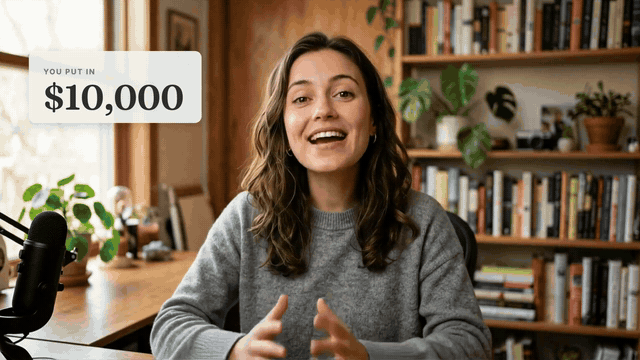

# B-Roll Skills

> Add b-roll to a talking-head video with your AI coding agent. It transcribes the recording, decides line by line when to show the speaker, when to lay a graphic over them and when to cover them with a full-frame one, draws every graphic from what is actually said, and renders the finished MP4 with the original sound. Your recording is never cut. No After Effects, no stock footage, no templates.



*SHOWCASE_CAPTION*

## Install

```bash
npx skills add iart-ai/b-roll-skills
```

Or add it as a Claude Code plugin marketplace:

```bash
/plugin marketplace add iart-ai/b-roll-skills
```

then `/plugin install b-roll-skills`.

## Ask for it

- "Here's my talking head video (talk.mp4). Make it more engaging to watch."
- "Add b-roll to lesson-03.mp4, I'm posting it on YouTube. Keep my face on screen for the intro and the outro."
- "Motion graphics for this ad read: show the price and the three features as I say them. I edit in Premiere."

## What it does

Every line of the recording gets one of three treatments:

| Treatment | What the viewer sees | Used for |
|---|---|---|
| **Speaker** | The recording alone | The opening, opinions and stories, the call to action, the closing line |
| **Overlay** | The speaker, with a small graphic beside them: a key word, a number counting up, a short list | One concrete thing worth seeing while the speaker is still worth watching |
| **Cover** | A full-frame graphic while the voice carries on: a chart, a comparison, a diagram, a sequence of steps | Lines that are better shown than said by a face |

The graphics are drawn from the transcript: the speaker's own numbers, names and words, never invented ones. Changes land between words, overlays stay off the face, and the speaker comes back between full-frame graphics so the video never turns into a slideshow with a voice-over.

## What you get

| File | What it is |
|---|---|
| `film.mp4` | The finished video: your recording, the b-roll on top, your original sound |
| `b-roll.webm` / `b-roll.mov` | When you edit in Premiere Pro, DaVinci Resolve or Final Cut: the b-roll alone with a transparent background (VP9 or ProRes 4444), to put on the track above your recording and keep editing |
| `page.html` | The page the graphics are drawn from: open it to play the film with sound and scrub through the scenes; change a word or a timing and render again |
| The plan | A table of time, what is said, treatment, and what is on screen |

## How it checks its own work

`render.mjs --check` reads the plan, the transcript and the pixels of every frame:

- every full-frame graphic hides the speaker completely once it is in;
- no overlay reaches into the box around the speaker's face;
- every change starts and ends in a gap between words, and it names the gap to move to when one doesn't;
- nothing is drawn outside a planned scene;
- and it warns about rhythm: more than about 8 seconds of only the speaker, a full-frame graphic shorter than 3 or longer than 8 seconds, two of them back to back, not opening or closing on the speaker.

Then the agent looks at a contact sheet of the whole film (one frame a second over the real recording) and full-size stills, and fixes what it sees.

## What's included

| Path | What it is |
|---|---|
| [skills/talking-head-b-roll/SKILL.md](./skills/talking-head-b-roll/SKILL.md) | The workflow: transcribe, plan each line, build, check, render |
| [templates/b-roll.html](./skills/talking-head-b-roll/templates/b-roll.html) | A transparent canvas page: the plan as `SCENES`, the face box, entrances and exits, text fitting, font loading, and a preview that plays your recording under the graphics |
| [scripts/transcribe.mjs](./skills/talking-head-b-roll/scripts/transcribe.mjs) | Word-timed transcript with local whisper.cpp (no key) or ElevenLabs Scribe |
| [scripts/render.mjs](./skills/talking-head-b-roll/scripts/render.mjs) | `--check`, contact sheets and stills over the recording, the finished MP4, the alpha layer |

## Which model

Built and tested with **Claude Opus 5.5**. Planning leans on reading the whole transcript, and the self-check on a model that can **look at images**: it reviews its own contact sheet and stills. Other models have not been tested with this pack.

## Requirements

Node 18+, `npm i playwright-core`, ffmpeg, and Chrome (or `npx playwright install chromium`). For the transcript, either:

- **whisper.cpp**, local and free: `brew install whisper-cpp`, then one model download:
  ```bash
  mkdir -p ~/.cache/whisper && curl -L -o ~/.cache/whisper/ggml-base.en.bin \
    https://huggingface.co/ggerganov/whisper.cpp/resolve/main/ggml-base.en.bin
  ```
  (English; for other languages use `ggml-small.bin` or larger.)
- or an **ElevenLabs** API key in `ELEVENLABS_API_KEY`.

The scripts find playwright-core installed in your working folder or any folder above it, or next to the skill. Fonts load from Google Fonts, so rendering needs network access.

## Topics

`b-roll` `talking-head` `motion-graphics` `video-editing` `youtube` `whisper` `transcription` `claude-skill`

## More packs

Part of the open-source motion skills collection. Full hub: **[github.com/iart-ai/motion-skills](https://github.com/iart-ai/motion-skills)**

## License

MIT

---

Built by **[iart.ai](https://iart.ai/ai-b-roll-generator?utm_source=github&utm_medium=readme&utm_campaign=b-roll-skills&utm_content=footer)**, the AI motion agent. Rather not run code? Upload your talking-head video at [iart.ai/ai-b-roll-generator](https://iart.ai/ai-b-roll-generator?utm_source=github&utm_medium=readme&utm_campaign=b-roll-skills&utm_content=no-code) and ask for b-roll in plain words.
